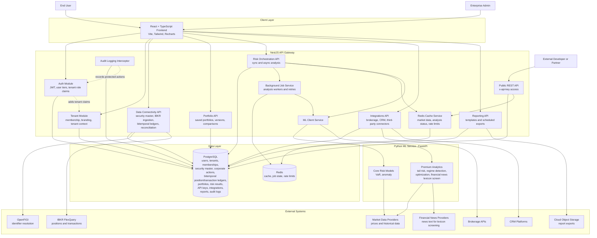
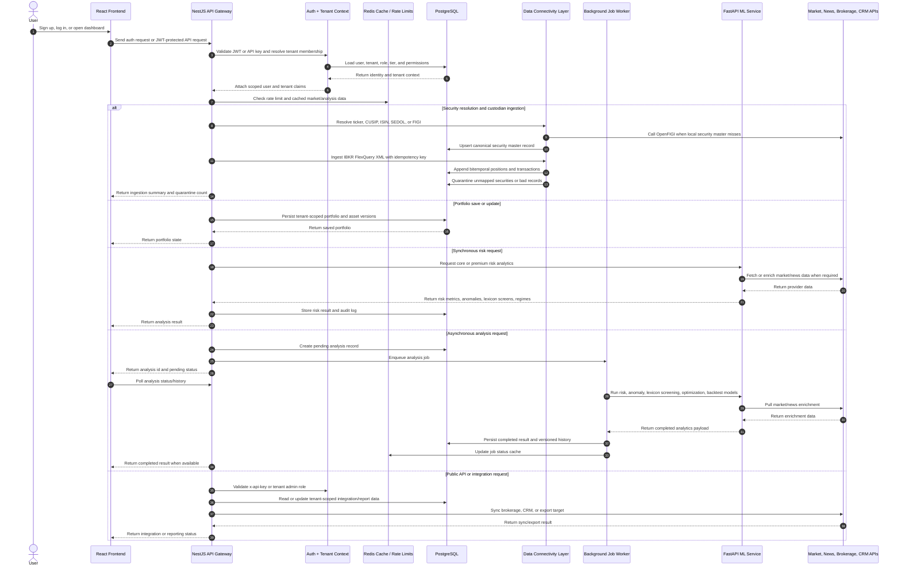

# AI Financial Risk & Intelligence Platform

Microservices platform for portfolio risk analytics and intelligence.

## Stack

- Frontend: React + TypeScript (Vite, Tailwind, Recharts)
- API Gateway: NestJS + TypeORM
- ML Service: FastAPI (VaR, anomaly, lexicon-based news screening)
- Database: PostgreSQL

## Architecture



### Architecture Flow



Primary flow: `React Frontend -> NestJS API Gateway -> PostgreSQL / Redis / FastAPI ML Service -> API Gateway -> React Frontend`.

Async analysis flow: `Frontend submits analysis -> API Gateway creates job -> Background worker calls ML Service -> results are persisted in PostgreSQL -> Frontend polls analysis status/history`.

Enterprise flow: tenant context is resolved from JWT claims or API keys, then portfolios, analyses, integrations, reports, and audit logs are scoped to the active tenant.

Data connectivity flow: identifiers are resolved into a canonical security master before positions enter the ledger; IBKR FlexQuery files are ingested idempotently; position and transaction facts are appended with both valid time and system time; unmapped or incomplete records go to quarantine; reconciliation runs compare custodian positions against internal portfolio quantities and produce break workflows with aging.

## Endpoints

### API Gateway
- `GET /health`
- `POST /auth/register`
- `POST /auth/login`
- `GET /auth/me`
- `POST /portfolio` (requires JWT)
- `GET /portfolios` (requires JWT)
- `GET /portfolios/:id` (requires JWT)
- `GET /risk/:id` (requires JWT)
- `POST /analyses` (requires JWT)
- `GET /analyses/:id` (requires JWT)
- `GET /portfolios/:id/analyses` (requires JWT)
- `GET /portfolios/:id/analyses/compare` (requires JWT)
- `GET /portfolios/:id/backtest` (requires JWT)
- `POST /api/v1/data/securities/resolve` (requires JWT)
- `POST /api/v1/data/ingestion/ibkr-flex` (requires JWT, analyst access)
- `GET /api/v1/data/positions/snapshot` (requires JWT)
- `POST /api/v1/data/reconciliation/runs` (requires JWT, analyst access)
- `GET /api/v1/data/reconciliation/breaks` (requires JWT)
- `PATCH /api/v1/data/reconciliation/breaks/:id` (requires JWT, analyst access)
- `GET /api/v1/data/quarantine` (requires JWT)
- `PATCH /api/v1/data/quarantine/:id` (requires JWT, analyst access)
- `GET /api/v1/data/corporate-actions` (requires JWT)
- `POST /api/v1/data/corporate-actions` (requires JWT, analyst access)
- `GET /api/v1/tenants` (requires JWT)
- `GET /api/v1/branding/current` (requires JWT)
- `PATCH /api/v1/admin/branding` (requires JWT, tenant admin)
- `GET /api/v1/admin/members` (requires JWT, tenant admin)
- `POST /api/v1/admin/members` (requires JWT, tenant admin)
- `POST /api/v1/developer/api-keys` (requires JWT, developer access)
- `GET /api/v1/developer/api-keys` (requires JWT, developer access)
- `DELETE /api/v1/developer/api-keys/:id` (requires JWT, developer access)
- `GET /api/v1/public/portfolios` (requires `x-api-key`)
- `GET /api/v1/integrations` (requires JWT)
- `POST /api/v1/integrations` (requires JWT, tenant admin)
- `POST /api/v1/integrations/:id/sync` (requires JWT, tenant admin)
- `POST /api/v1/reports/templates` (requires JWT, analyst access)
- `GET /api/v1/reports/templates` (requires JWT)
- `POST /api/v1/reports/schedules` (requires JWT, analyst access)
- `GET /api/v1/reports/schedules` (requires JWT)

### ML Service
- `GET /`
- `GET /health`
- `GET /docs`
- `POST /risk`
- `POST /anomaly`
- `POST /advanced-risk`
- `POST /regime`
- `POST /optimize`
- `POST /factor-exposures`
- `POST /var-backtest`
- `POST /financial-lexicon-screen`

## Local Setup (macOS, No Docker)

### 1) Install and start PostgreSQL

```bash
brew update
brew install postgresql@16
brew services start postgresql@16
brew services list | grep postgresql
```

### 2) Create DB user and database

```bash
psql postgres
```

```sql
CREATE ROLE postgres WITH LOGIN PASSWORD 'postgres';
CREATE DATABASE finance_db OWNER postgres;
GRANT ALL PRIVILEGES ON DATABASE finance_db TO postgres;
\q
```

If the `postgres` role already exists, just run:

```sql
ALTER USER postgres WITH PASSWORD 'postgres';
```

### 3) Configure environment variables

`api-gateway/.env`

```env
PORT=4000
DB_HOST=localhost
DB_PORT=5432
DB_USER=postgres
DB_PASSWORD=postgres
DB_NAME=finance_db
DB_RETRY_ATTEMPTS=8
DB_RETRY_DELAY=3000
DB_LOGGING=true
ML_SERVICE_URL=http://localhost:8000
CORS_ORIGIN=http://localhost:5173
TYPEORM_SYNC=false
JWT_SECRET=replace-with-a-long-random-secret
JWT_EXPIRES_IN=1h
REDIS_URL=redis://localhost:6379
JOB_WORKER_CONCURRENCY=2
JOB_MAX_ATTEMPTS=3
RATE_LIMIT_TTL_MS=60000
RATE_LIMIT_MAX=120
DB_POOL_MAX=10
DB_POOL_IDLE_TIMEOUT_MS=30000
DB_POOL_CONNECTION_TIMEOUT_MS=5000
OPENFIGI_API_KEY=
FINNHUB_API_KEY=
```

Schema changes are migration-only. Do not enable TypeORM `synchronize`.

Run migrations explicitly:

```bash
cd api-gateway
npm run migration:run
```

Run the tenant isolation smoke test against a running API Gateway:

```bash
cd api-gateway
npm run test:tenant-isolation
```

`frontend/.env`

```env
VITE_API_URL=http://localhost:4000
```

### 4) Run ML service

```bash
cd ml-service
python3 -m venv .venv
source .venv/bin/activate
pip install -r requirements.txt
uvicorn main:app --reload --host 0.0.0.0 --port 8000
```

Open [http://127.0.0.1:8000/docs](http://127.0.0.1:8000/docs).

### 5) Run API Gateway

```bash
cd api-gateway
npm install
npm run start:dev
```

The gateway reads DB config from env via `ConfigService` in [database.config.ts](/Users/abhinavbinu/AI-Financial-Risk-Intelligence-Platform/AI-Financial-Risk-Intelligence-Platform/api-gateway/src/config/database.config.ts).

### 6) Run Frontend

```bash
cd frontend
npm install
npm run dev
```

Open [http://localhost:5173](http://localhost:5173).

## Production Safety Invariants

- Database schema changes use checked-in TypeORM migrations only; `synchronize` is hard-disabled in code.
- Monetary, quantity, and weight columns use PostgreSQL `NUMERIC(28,10)`.
- Gateway arithmetic uses `decimal.js` for stored monetary and weight calculations.
- Python ML reportable outputs are Decimal-quantized at service boundaries for deterministic rounding.
- Tenant-owned tables have Row-Level Security policies in the production safety migration.
- API keys are Argon2id-hashed, shown once at creation, displayed later by prefix/last four, scoped, rate-limited, and audit-logged on use.
- Access tokens live in httpOnly cookies; refresh tokens rotate with reuse detection and user-level forced invalidation.

## Authentication Guide

The platform uses email/password authentication with short-lived JWT access tokens in httpOnly cookies and rotating refresh tokens.

Current behavior:

- Users register or log in through the React frontend.
- The API Gateway sets a 15-minute `access_token` httpOnly cookie.
- The API Gateway sets a rotating `refresh_token` httpOnly cookie scoped to `/auth`.
- The frontend sends credentials with requests and never stores JWTs in `localStorage`.
- Refresh-token reuse increments `users.token_version`, invalidating outstanding access tokens.
- Portfolios are scoped to the authenticated user and tenant.

### Required environment variables

Add these to `api-gateway/.env`:

```env
JWT_SECRET=replace-with-a-long-random-secret
JWT_EXPIRES_IN=15m
```

For local development, any long random string works for `JWT_SECRET`.
For production, store it in your deployment secret manager and rotate it carefully.

### Register a user

```bash
curl -X POST http://localhost:4000/auth/register \
  -H "Content-Type: application/json" \
  -d '{
    "name": "Demo User",
    "email": "demo@example.com",
    "password": "password123"
  }'
```

Response:

```json
{
  "user": {
    "id": "user-id",
    "email": "demo@example.com",
    "name": "Demo User",
    "tier": "free"
  }
}
```

### Log in

```bash
curl -X POST http://localhost:4000/auth/login \
  -H "Content-Type: application/json" \
  -d '{
    "email": "demo@example.com",
    "password": "password123"
  }'
```

### Verify the current user

```bash
curl http://localhost:4000/auth/me \
  -b "access_token=<cookie-value>"
```

### Use protected portfolio endpoints

Create portfolio:

```bash
curl -X POST http://localhost:4000/portfolio \
  -b "access_token=<cookie-value>" \
  -H "Content-Type: application/json" \
  -d @data/sample-portfolio.json
```

List saved portfolios:

```bash
curl http://localhost:4000/portfolios \
  -b "access_token=<cookie-value>"
```

Get risk:

```bash
curl http://localhost:4000/risk/<portfolioId> \
  -b "access_token=<cookie-value>"
```

Create async analysis:

```bash
curl -X POST http://localhost:4000/analyses \
  -b "access_token=<cookie-value>" \
  -H "Content-Type: application/json" \
  -d '{"portfolioId":"<portfolioId>"}'
```

Poll analysis status:

```bash
curl http://localhost:4000/analyses/<analysisId> \
  -b "access_token=<cookie-value>"
```

List analysis history:

```bash
curl http://localhost:4000/portfolios/<portfolioId>/analyses \
  -b "access_token=<cookie-value>"
```

Run a backtest:

```bash
curl "http://localhost:4000/portfolios/<portfolioId>/backtest?periods=180" \
  -b "access_token=<cookie-value>"
```

## Data Connectivity Guide

The data layer is built around five production invariants:

- Resolve every instrument into the security master before aggregation.
- Store positions and transactions as append-only bitemporal facts.
- Never duplicate records when the same custodian file is replayed.
- Quarantine unmapped securities and bad records instead of silently ingesting them.
- Reconcile custodian books against internal portfolio records and track breaks through workflow.

### Resolve a security

The gateway first checks `security_master`; if no local match exists, it calls OpenFIGI.

```bash
curl -X POST http://localhost:4000/api/v1/data/securities/resolve \
  -b "access_token=<cookie-value>" \
  -H "Content-Type: application/json" \
  -d '{"ticker":"AAPL"}'
```

Supported identifiers: `ticker`, `cusip`, `isin`, `sedol`, `figi`.

### Ingest an IBKR FlexQuery XML file

The ingestion endpoint is idempotent by file hash and optional idempotency key. Replaying the same file returns the existing ingestion run instead of creating duplicate ledger rows.

```bash
curl -X POST http://localhost:4000/api/v1/data/ingestion/ibkr-flex \
  -b "access_token=<cookie-value>" \
  -H "Content-Type: application/json" \
  -d '{
    "idempotencyKey": "ibkr-flex-2026-03-31-v1",
    "externalAccountId": "U1234567",
    "xml": "<FlexQueryResponse>...</FlexQueryResponse>"
  }'
```

### Reproduce a historical position view

Use `validAt` for the market-effective date and `systemAt` for what the platform knew at that point in time.

```bash
curl "http://localhost:4000/api/v1/data/positions/snapshot?validAt=2026-03-31T23:59:59Z&systemAt=2026-04-01T12:00:00Z" \
  -b "access_token=<cookie-value>"
```

### Run reconciliation

This compares latest IBKR ledger positions to internal portfolio quantities and creates break records.

```bash
curl -X POST http://localhost:4000/api/v1/data/reconciliation/runs \
  -b "access_token=<cookie-value>" \
  -H "Content-Type: application/json" \
  -d '{"asOfDate":"2026-03-31T23:59:59Z","externalAccountId":"U1234567"}'
```

Review and update breaks:

```bash
curl http://localhost:4000/api/v1/data/reconciliation/breaks \
  -b "access_token=<cookie-value>"

curl -X PATCH http://localhost:4000/api/v1/data/reconciliation/breaks/<breakId> \
  -b "access_token=<cookie-value>" \
  -H "Content-Type: application/json" \
  -d '{"status":"assigned","assignedTo":"ops@example.com"}'
```

Review quarantine:

```bash
curl http://localhost:4000/api/v1/data/quarantine \
  -b "access_token=<cookie-value>"
```

Record a corporate action:

```bash
curl -X POST http://localhost:4000/api/v1/data/corporate-actions \
  -b "access_token=<cookie-value>" \
  -H "Content-Type: application/json" \
  -d '{
    "actionType": "split",
    "ticker": "AAPL",
    "exDate": "2020-08-31T00:00:00Z",
    "ratio": "4"
  }'
```

### Frontend auth flow

Open [http://localhost:5173](http://localhost:5173).

The app shows a login/register screen first. After authentication, users can:

- Create a portfolio and run analysis.
- See saved portfolios for their account.
- Rerun analysis for a saved portfolio.
- Log out from the dashboard header.

## Phase 2 Scaling

Phase 2 adds asynchronous analysis processing, analysis history, comparison APIs, backtesting, Redis-compatible caching, gateway rate limiting, and database pool configuration.

See [PHASE2_SCALING.md](/Users/abhinavbinu/AI-Financial-Risk-Intelligence-Platform/AI-Financial-Risk-Intelligence-Platform/docs/PHASE2_SCALING.md) for the production architecture guide.

## Phase 3 Premium Features

Phase 3 adds premium analytics designed for enterprise value: tail risk, market regime detection, portfolio optimization, finance-domain lexicon screening, audit logging, and API version metadata.

See [PHASE3_PREMIUM_FEATURES.md](/Users/abhinavbinu/AI-Financial-Risk-Intelligence-Platform/AI-Financial-Risk-Intelligence-Platform/docs/PHASE3_PREMIUM_FEATURES.md) for the feature architecture, ML model plan, security implications, and milestones.

## Phase 4 Enterprise Platform

Phase 4 adds the enterprise SaaS platform layer: tenants, tenant-scoped data, white-label branding, hashed API keys, public REST APIs, integration scaffolding, and scheduled report definitions.

See [PHASE4_ENTERPRISE_PLATFORM.md](/Users/abhinavbinu/AI-Financial-Risk-Intelligence-Platform/AI-Financial-Risk-Intelligence-Platform/docs/PHASE4_ENTERPRISE_PLATFORM.md) for the multi-tenant architecture, RLS guidance, API design, and implementation roadmap.

### Security notes

This is Phase 1 authentication, built for local development and PMF validation.
Before production, add refresh tokens in secure HttpOnly cookies, rate limiting on auth routes, OAuth providers, password reset, and stricter secret management.

## Common Local Errors

### `ECONNREFUSED 127.0.0.1:5432`
PostgreSQL is not running or not listening on port 5432.

Check:

```bash
brew services list | grep postgresql
lsof -iTCP:5432 -sTCP:LISTEN
```

### `ENOTFOUND postgres`
`DB_HOST=postgres` is Docker-only hostname. For local native run, use `DB_HOST=localhost`.

## Optional Cleanup (if you never want Docker)

From project root:

```bash
rm docker-compose.yml
rm frontend/Dockerfile
rm api-gateway/Dockerfile
rm ml-service/Dockerfile
```
